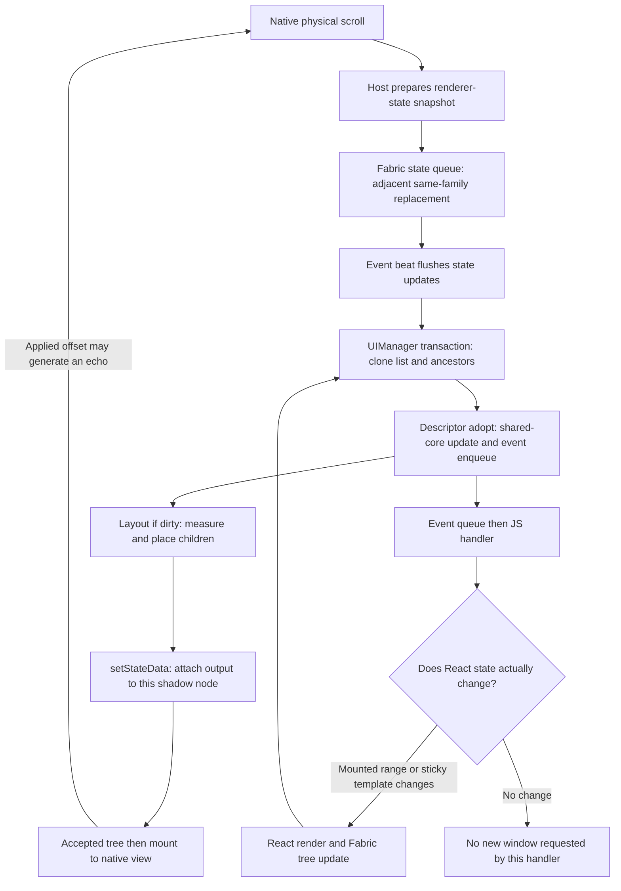

# ShadowList Fabric events, React state, and shadow-node performance

Date: 2026-09-06  
Repository revision: `42d306db787270e926db10c6d2368f91a04fb6ed`  
Framework baseline: React Native `0.85.0`, as declared by the package/example; React `19.2.3`.

Analysis only. No implementation, generated code, dependencies, or tests were changed. This report extends [the core/Fabric performance report](PERFORMANCE_REPORT.md), particularly F5, F9, F10, and F12. Its findings are source-based, not device timing measurements.

## Executive assessment

The main opportunity is not simply to reduce React `setState` calls. Work is duplicated across three different mechanisms: native-to-renderer state updates, native-to-JS events, and shadow-node cloning. The existing JS range hook already suppresses many actual window changes, but only after much of the native and event-delivery cost has occurred.

The most consequential findings are:

1. **`adopt()` is doing transaction work in a node-construction hook.** Every relevant creation/clone can copy inputs, run the virtualizer, mutate the shared core, and emit events. This can happen before a tree is accepted, including retries and discarded work.
2. **Fabric already coalesces adjacent state updates, but this does not remove state preparation costs or merge independent changes.** ShadowList sends full snapshots containing geometry and command fields; an ordinary scroll sample can supersede an independently prepared command snapshot.
3. **ShadowList's generated events are ordinary events, unlike RN ScrollView's unique scroll event.** Native range deduplication helps, but distinct queued ranges can still build up. Switching every event to “unique” is insufficient when event types interleave.
4. **Range payloads lack dataset identity.** A delayed numeric range can be decoded against newer data. More aggressive scheduling/coalescing needs a versioned request/acknowledgment protocol, not merely a throttle.
5. **The JS state owner is too broad for sticky-header updates.** Changing the active section header reruns the list component's mounted-row mapping even though most rows are unchanged. Row memoization helps child rendering, not this parent work.
6. **Shadow-node layout performs avoidable cloning and measurement feedback.** Known child indices are not supplied to replacement, and unchanged rows are cloned. These amplify the core suffix-reflow issue from the original report.

Start with cheap state access, optional-event gating, measurement no-op detection, and indexed child replacement. Treat event coalescing, state/command separation, and making core computation transaction-safe as coordinated architectural work.

## Evidence and limits

Local navigation used SymbolPeek for supported languages and targeted C++/Objective-C++ reads. The C++ review focused on value copies, shared ownership, mutation, and retry safety. Upstream renderer and Codegen sources were inspected at the pinned RN tag; links below point to those primary sources.

Dependencies are not installed, so the generated `EventEmitters.cpp` for an actual application build was unavailable. Event-generation behavior was verified against the RN `0.85.0` generator template. Platform feature-flag overrides, actual commit contention, event queue depths, and device frame timing remain unmeasured. The package's wider peer-version range requires separate compatibility verification before using renderer internals.

“Code-proven” below means the operation or scheduling possibility is established by source. It does not mean a race was reproduced or a particular percentage of frame time was measured. Queue examples are deterministic models of inspected algorithms, not executions of Fabric.

## 1. The actual feedback loop

This diagram does not imply one commit, layout, or React render per native callback. Retries and shared scheduling make those counts different.

### Four operations that must not be conflated

| Operation                                                              | What actually happens                                                                                                                         |
| ---------------------------------------------------------------------- | --------------------------------------------------------------------------------------------------------------------------------------------- |
| Native scroll-view movement                                            | The platform scroll view moves; native sticky/drag transforms can update immediately.                                                         |
| Host `ConcreteState::updateState` / Android `StateWrapper.updateState` | Requests a renderer-state transaction. Does not itself mean a React component renders.                                                        |
| React hook `setState`                                                  | Queues a React update; equality can avoid rendering, depending on pending work. A changed range/header can produce new Fabric children.       |
| Shadow-node `setStateData` during layout                               | Attaches state to the current unsealed node. It does **not** enqueue another native-state update or independently begin a second transaction. |

The last distinction follows from [ConcreteShadowNode](https://raw.githubusercontent.com/facebook/react-native/v0.85.0/packages/react-native/ReactCommon/react/renderer/core/ConcreteShadowNode.h). Here it is called at [ShadowList layout line 376](packages/shadowlist-fabric/cpp/react/renderer/components/ShadowListViewSpec/ShadowListViewShadowNode.cpp#L376). Subsequent work can result from mounting an offset correction and receiving its scroll echo, not from `setStateData` recursively dispatching itself.

### C++ implementation does not imply independence from JS scheduling

In the inspected default asynchronous path, [EventBeat](https://raw.githubusercontent.com/facebook/react-native/v0.85.0/packages/react-native/ReactCommon/react/renderer/core/EventBeat.cpp) schedules its callback through the runtime scheduler. [EventQueue](https://raw.githubusercontent.com/facebook/react-native/v0.85.0/packages/react-native/ReactCommon/react/renderer/core/EventQueue.cpp) flushes state updates before events. [Scheduler](https://raw.githubusercontent.com/facebook/react-native/v0.85.0/packages/react-native/ReactCommon/react/renderer/scheduler/Scheduler.cpp) routes surviving state updates into `UIManager::updateState`.

Thus the virtualizer can execute entirely in C++ without invoking a React component, yet the route that starts that work can still wait behind JS-runtime scheduling. A busy JS runtime can delay fresh virtualization decisions and newly mounted rows while the native scroll view continues moving. Platform beat configuration and immediate-update paths can alter this behavior; no single-thread claim applies to every Fabric operation.

## 2. Native state: coalescing, copying, and lost intent

### S1. Queue coalescing already exists, after expensive preparation

RN's state queue replaces only its immediately preceding update when both belong to the same component family. It does not merge their fields or compose their callbacks. This is explicit in [EventQueue::enqueueStateUpdate](https://raw.githubusercontent.com/facebook/react-native/v0.85.0/packages/react-native/ReactCommon/react/renderer/core/EventQueue.cpp).

| Submitted before a flush | Surviving state updates |
| ------------------------ | ----------------------- |
| `A1, A2, A3`             | `A3`                    |
| `A1, B1, A2`             | `A1, B1, A2`            |

These outputs were reproduced with a small in-memory model of the queue algorithm. They establish why “every scroll callback causes a commit” is incorrect, and why multiple active lists may coalesce differently from one list.

However, [iOS scroll reporting](packages/shadowlist-fabric/ios/ShadowListView.mm#L480) copies the current state before submitting it. On Android, the host creates a small map, but [ShadowListViewState's partial-update constructor](packages/shadowlist-fabric/cpp/react/renderer/components/ShadowListViewSpec/ShadowListViewState.h#L55) copies the previous sticky/snap vectors. Those costs happen before queue replacement can discard an update.

**Optimization:** reduce preparation costs first. Only then assess a host-side latest-sample mechanism using actual submitted/surviving counts. A second coalescer cannot claim to eliminate commits Fabric already avoids; its incremental benefit may chiefly be fewer allocations and copies.

### S2. Full state snapshots cross too many boundaries

[ConcreteState::getData](https://raw.githubusercontent.com/facebook/react-native/v0.85.0/packages/react-native/ReactCommon/react/renderer/core/ConcreteState.h) returns a const reference. Nevertheless, the [descriptor line 46](packages/shadowlist-fabric/cpp/react/renderer/components/ShadowListViewSpec/ShadowListViewComponentDescriptor.h#L46) uses plain `auto`, copying every vector and string. That read is not modified and is a direct reference-access candidate.

The host convenience overload `updateState(Data&&)` also captures the submitted value and later constructs a new immutable `Data` from that capture. The current copyable state therefore undergoes another copy when the transaction callback executes, potentially again on retry. Moving into the API does not make the whole pipeline zero-copy. Layout additionally copies state before it knows whether any output needs publishing. See [ConcreteState](https://raw.githubusercontent.com/facebook/react-native/v0.85.0/packages/react-native/ReactCommon/react/renderer/core/ConcreteState.h) and [local publication preparation](packages/shadowlist-fabric/cpp/react/renderer/components/ShadowListViewSpec/ShadowListViewShadowNode.cpp#L295).

**Optimization:** represent large, infrequently changing geometry as an immutable shared snapshot with a generation. Keep high-frequency host inputs small. Compute changes before materializing a replacement output. Geometry must never be mutated through a pointer shared with an accepted/older tree; sharing only helps if immutability is real.

This overlaps original F5 rather than adding an independent performance multiplier.

### S3. Partial Android maps are not transaction-time merges

The Android `ConcreteState::updateState(dynamic)` overload constructs `Data(getData(), incomingMap)` before enqueueing the resulting value. Missing map fields come from the state wrapper's snapshot, not from the latest state passed to the eventual transaction callback. iOS explicitly builds an equivalent full snapshot. See [ConcreteState](https://raw.githubusercontent.com/facebook/react-native/v0.85.0/packages/react-native/ReactCommon/react/renderer/core/ConcreteState.h), [Android scroll submission](packages/shadowlist-fabric/android/src/main/java/com/shadowlist/ShadowListView.java#L509), and [iOS command submission](packages/shadowlist-fabric/ios/ShadowListView.mm#L615).

A possible interleaving, not a reproduced device failure:

1. The host holds state `{offset: 0, commandSequence: 0}`.
2. A command submits `{offset: 0, commandSequence: 1}`.
3. Before a new mounted state reaches the host, scrolling submits `{offset: 100, commandSequence: 0}` based on the same old snapshot.
4. If both updates are adjacent in the queue, only the scroll snapshot survives. The command was not merged into it.

The same pattern can carry stale geometry or drag fields forward. Command sequences derived from the last mounted state can also repeat across a burst of commands. These are protocol risks established by the producer/queue combination; their incidence needs stress tests.

**Optimization:** distinguish replaceable samples from commands and transitions. Maintain a small accumulated host-input snapshot so later scroll samples retain outstanding intents; use monotonic host-side command identities and explicit acknowledgment. If every command/drag transition must be observed, use a separately sequenced pending-intent mechanism rather than a single “latest event” slot. Whether intermediate scroll-to commands are intentionally last-wins must be specified.

A functional state updater can merge host inputs onto the latest renderer state and preserve newer layout output. But merely changing each independent field update to a callback is insufficient: the queue still discards adjacent callbacks. The last surviving submission must preserve every intent that is supposed to survive, and callbacks must be pure/replayable.

### S4. Android reads serialize geometry even when only a sequence is needed

[StateWrapperImpl.kt](https://raw.githubusercontent.com/facebook/react-native/v0.85.0/packages/react-native/ReactAndroid/src/main/java/com/facebook/react/fabric/StateWrapperImpl.kt) calls into native code on each state-data read. The [JNI implementation](https://raw.githubusercontent.com/facebook/react-native/v0.85.0/packages/react-native/ReactAndroid/src/main/jni/react/fabric/StateWrapperImpl.cpp) invokes `getDynamic()` to create a readable map. ShadowList's [getDynamic](packages/shadowlist-fabric/cpp/react/renderer/components/ShadowListViewSpec/ShadowListViewState.h#L106) serializes every sticky and snap array.

Consequently, [scrollToIndex](packages/shadowlist-fabric/android/src/main/java/com/shadowlist/ShadowListView.java#L662) and [scrollToEnd](packages/shadowlist-fabric/android/src/main/java/com/shadowlist/ShadowListView.java#L699) can serialize full geometry just to obtain the command sequence. Native mounted-state handling also reconstructs arrays.

**Optimization:** cache accepted scalar values/generations in the host and maintain command IDs independently. Avoid re-reading serialized state for one scalar. For the main geometry path, evaluate an immutable native representation or supported structured transport only after measuring conversion cost; adding MapBuffer alone is not enough if the Java consumer continues to call `getStateData()`.

## 3. Events: what is queued, what is optional, and what must remain ordered

### E1. Generated scroll events do not inherit ScrollView's coalescing

The inspected [Codegen event-emitter template](https://raw.githubusercontent.com/facebook/react-native/v0.85.0/packages/react-native-codegen/src/generators/components/GenerateEventEmitterCpp.js) generates ordinary `dispatchEvent` calls. `DirectEventHandler` describes event propagation, not a promise of coalescing or a particular scheduling priority. In contrast, [RN ScrollView's emitter](https://raw.githubusercontent.com/facebook/react-native/v0.85.0/packages/react-native/ReactCommon/react/renderer/components/scrollview/ScrollViewEventEmitter.cpp) explicitly uses `dispatchUniqueEvent` for scrolling.

ShadowList's [core observer dispatch](packages/shadowlist-core/Container.cpp#L306) emits ranges only when indices change and scroll only when offsets change. This is useful producer deduplication. It does not remove distinct obsolete samples already waiting for JS.

**Optimization:** separate the private “render this viewport” snapshot from public event semantics. A latest-value pending snapshot can overwrite obsolete internal requests without constructing and queueing one event per intermediate update. Do not patch generated output; implement a supported custom emitter/adapter or change the source-level integration with version compatibility tests.

### E2. Making each event unique does not solve interleaved backlog

RN's unique-event replacement stops at the most recent event for the same target. A different event type on that target is an ordering barrier. See [EventQueue::enqueueEvent](https://raw.githubusercontent.com/facebook/react-native/v0.85.0/packages/react-native/ReactCommon/react/renderer/core/EventQueue.cpp).

| Queue input, all on one list    | Result            |
| ------------------------------- | ----------------- |
| Ordinary `S1, S2, S3`           | All three remain  |
| Unique `S1, S2, S3`             | Only `S3` remains |
| Unique `V1, W1, S1, V2, W2, S2` | All six remain    |

`V` denotes mounted-demand range, `W` viewable range, and `S` scroll. The local core emits these in that order when all change. The results above were checked with a direct model of RN's replacement rules; there is no claim about actual queue depth on a device.

**Optimization:** consider a single versioned internal viewport snapshot or a per-family pending snapshot read lazily when an already-scheduled event is delivered. [BaseViewEventEmitter's onLayout](https://raw.githubusercontent.com/facebook/react-native/v0.85.0/packages/react-native/ReactCommon/react/renderer/components/view/BaseViewEventEmitter.cpp) demonstrates a latest-value/in-flight pattern worth studying, not copying without adapting its semantics.

Public viewability, edge, and drag events need independent contracts. Coalescing viewability can omit transiently visible rows; coalescing pickup/drop can lose a required transition. Last-wins is suitable for a rendering snapshot, not automatically for every observer.

### E3. Omitting a JS handler does not stop native event preparation

The [descriptor](packages/shadowlist-fabric/cpp/react/renderer/components/ShadowListViewSpec/ShadowListViewComponentDescriptor.h#L64) installs scroll, viewable, and edge callbacks unconditionally. The core therefore sees a nonempty viewability callback even when the wrapper omits its JS handler.

[EventEmitter](https://raw.githubusercontent.com/facebook/react-native/v0.85.0/packages/react-native/ReactCommon/react/renderer/core/EventEmitter.cpp) creates the payload wrapper and dispatches without checking a JS callback prop. [UIManagerBinding](https://raw.githubusercontent.com/facebook/react-native/v0.85.0/packages/react-native/ReactCommon/react/renderer/uimanager/UIManagerBinding.cpp) materializes the JSI payload before invoking React's event handler. For a live target on the ordinary path, an absent consumer does not eliminate these earlier costs; interceptors and unavailable targets can change eventual delivery.

**Optimization:** communicate explicit native capabilities: public scroll listener present, public viewability needed, sticky-template tracking needed, edge listener enabled. Gate work at its producer. Mount-demand tracking is required internally and must stay enabled. Sticky sections may still need internal viewability even when the application has no viewability callback.

Listener changes need a defined initial/current snapshot behavior. Enabling a listener after deduplication state advanced must not leave it waiting indefinitely for the next numeric change.

### E4. Event priority is not determined by the name `onScroll`

Ordinary emitter dispatch defaults to `Unspecified`; unique dispatch uses `Continuous`. The exact React priority depends on [EventQueueProcessor](https://raw.githubusercontent.com/facebook/react-native/v0.85.0/packages/react-native/ReactCommon/react/renderer/core/EventQueueProcessor.cpp), including the `fixMappingOfEventPrioritiesBetweenFabricAndReact` feature flag and active continuous-event state. With the legacy mapping, unspecified events outside a continuous gesture can map to discrete work; the alternate mapping uses default priority in that case. The [default flag header](https://raw.githubusercontent.com/facebook/react-native/v0.85.0/packages/react-native/ReactCommon/react/featureflags/ReactNativeFeatureFlagsDefaults.h) is not proof of an application's platform overrides.

**Optimization:** make cadence and priority deliberate, then verify the runtime flags. Internal mount-demand updates must arrive soon enough to avoid blank content. Public analytics can usually tolerate more deferral, subject to the existing API contract. Blanket discrete priority can starve other work; blanket transitions or JS animation-frame deferral can add virtualization latency.

### E5. Numeric ranges need a dataset generation

The [native event types](packages/shadowlist-fabric/src/ShadowListViewNativeComponent.ts#L9) contain start/end indices, but no dataset generation, sequence, or stable boundary keys. [useMountedRange](packages/shadowlist-fabric/src/virtualizer/useMountedRange.ts#L105) converts those indices to keys using the handler's current `data`. Its bounds checks reject invalid indices, not valid indices belonging to an older ordering.

For example, an event for rows 100–120 can remain numerically valid after a prepend but identify different items. [useViewability](packages/shadowlist-fabric/src/virtualizer/useViewability.ts#L124) has the same decoding issue. Native measured-child feedback already resolves stable keys to current indices; JS event decoding does not have equivalent identity information.

**Optimization:** include a data generation and viewport-request sequence. Decode against the matching dataset or discard stale snapshots and request/replay the latest generation. Stable boundary keys help range identity but cannot reconstruct every intermediate viewability token after arbitrary reordering. Reset numeric deduplication on generation/listener changes so an unchanged pair of indices can still represent changed content.

This is a correctness prerequisite for aggressive coalescing, not just an allocation optimization.

## 4. JS state: where renders are already avoided and where they spread

### J1. Mounted-range hysteresis already provides a meaningful bailout

[useMountedRange](packages/shadowlist-fabric/src/virtualizer/useMountedRange.ts#L117) returns the existing state when the incoming range remains within the retained key boundaries. It adds four rows of padding on either side when expanding/replacing the range. A native range event therefore does not imply a new mounted window.

React's inspected [production Fabric renderer](https://raw.githubusercontent.com/facebook/react-native/v0.85.0/packages/react-native/Libraries/Renderer/implementations/ReactFabric-prod.js) can eagerly bail out of a hook update when the result is referentially equal and the relevant fibers have no pending work. The update object/handler execution still exists, and pending work changes that fast-path eligibility. The renderer also already batches event-handler execution; adding a generic batching wrapper is not the missing optimization.

**Optimization:** keep this hysteresis. An event-handler ref guard can reduce repeated hook-update preparation, but it is a small downstream saving and must follow committed state/data generations, not assume an enqueued concurrent update committed. The larger opportunity is to avoid sending internal requests that acknowledged mounted coverage already satisfies.

Native coverage gating needs **accepted mounted coverage**, not merely the last requested range. If JS has not supplied the requested children, treating that request as fulfilled risks blanks. Use generation plus acknowledgment, account for direction/velocity and disjoint persistent rows, and retain final/command/resize delivery. Do not implement a fixed pixel throttle without this protocol.

### J2. Sticky-header state reruns the list's parent work

`activeStickyIndex` lives in [useViewability](packages/shadowlist-fabric/src/virtualizer/useViewability.ts#L42), which is called inside `ShadowListInner`. Its setter already returns the previous index when unchanged. When it does change, the owning list component rerenders and evaluates [renderIndices.map](packages/shadowlist-fabric/src/ShadowList.tsx#L285), creates row-wrapper elements, and invokes key extraction for mounted rows. [ElementRenderer memoization](packages/shadowlist-fabric/src/virtualizer/ElementRenderer.tsx#L14) can avoid child content rendering, not the parent's mapping/reconciliation preparation.

**Optimization:** put sticky-template subscription/state in a separately rendered overlay owner so section changes do not execute the entire list render function. Moving code into another hook does not isolate its state owner. Likewise, separate a mounted-window owner from unrelated low-frequency UI state where the resulting component boundaries actually prevent parent work.

This does not automatically eliminate native work: changing a descendant can still cause Fabric to clone its ancestors, including the list. Cheap, transaction-safe adoption remains important even after excellent React memoization. Keep physical sticky positioning on the native scroll path.

### J3. Viewability callbacks can cause application-level feedback

[useViewability](packages/shadowlist-fabric/src/virtualizer/useViewability.ts#L73) builds tokens for the viewable range, allocates two sets plus diff arrays, and calls the application only when key membership changes. When no public callback is supplied, it skips that token/diff work after internal sticky/window tracking. This is already sensible gating on the JS side.

The [ActivityScreen example](packages/shadowlist-fabric-example/src/ActivityScreen.tsx#L58) changes a label from viewability, which changes its memoized footer and feeds a new prop back into the list. Its scroll handler only changes header state on a threshold crossing; it is **not** setting React state every pixel.

**Optimization:** isolate frequently changing application status UI where practical. Incrementally maintain viewability differences for same-generation overlapping ranges if profiling shows allocation pressure. Preserve existing callback order and token semantics; do not assume reporting only the newest range is equivalent to reporting each visibility transition.

With narrow windows, token allocation is likely smaller than core work and native snapshots. Measure it before replacing straightforward sets with a complex cache.

## 5. Shadow nodes: speculative work and lost structural sharing

### N1. `adopt()` is not an accepted-commit callback

[ConcreteComponentDescriptor](https://raw.githubusercontent.com/facebook/react-native/v0.85.0/packages/react-native/ReactCommon/react/renderer/core/ConcreteComponentDescriptor.h) calls `adopt()` for node creation and cloning. [ShadowNode::cloneTree](https://raw.githubusercontent.com/facebook/react-native/v0.85.0/packages/react-native/ReactCommon/react/renderer/core/ShadowNode.cpp) clones the changed node and its ancestor path. [ShadowTree](https://raw.githubusercontent.com/facebook/react-native/v0.85.0/packages/react-native/ReactCommon/react/renderer/mounting/ShadowTree.cpp) can retry transactions; layout occurs before the final revision-conflict check. Hooks can also cancel a candidate tree.

ShadowList's [adopt implementation](packages/shadowlist-fabric/cpp/react/renderer/components/ShadowListViewSpec/ShadowListViewComponentDescriptor.h#L23) nevertheless mutates the shared `Container`, rebinds five callbacks, consumes drag sequences, requests commands, copies keys/configuration, and runs `Virtualizer::update`. Core observer dispatch and its previous-range/edge bookkeeping run during that update. The mutex serializes access but does not roll speculative changes back when Fabric rejects a candidate.

**Consequences:**

- Adoption count can exceed accepted commits; substantial CPU is spent on attempts that never mount.
- An unrelated descendant update can trigger list adoption. Nested-list updates can also clone an outer list's ancestor node.
- Event payloads can describe provisional core state, and deduplication can advance before acceptance. The exact user-visible symptom depends on the interleaving; this is an architectural risk, not a reproduced race.
- Events are enqueued before the later Yoga measurement feedback finishes, so the observed range may also precede final geometry correction.

**Optimization:** make adoption predominantly cheap attachment/initialization. Compute geometry/window changes in an explicitly versioned, replayable transaction using immutable inputs and per-candidate output. Publish accepted state and externally observable events using a verified acceptance boundary. Cache expensive inputs by data/config/geometry generations, not merely by a mutable shared “last seen” value written by a speculative clone.

Do not naively move every event to native mount. Initial virtualization needs a way to request children before the complete desired window exists. Separate a versioned speculative render-demand request from public viewability/edge/drag observations; the former may intentionally precede acceptance, whereas the latter needs a defined consistency contract. Choosing a renderer hook compatible with all supported RN versions requires a prototype.

Binding core callbacks once per family may remove repeated emitter copies/function assignment, but it is secondary to eliminating repeated core updates. Preserve emitter/family lifetime and avoid ownership cycles.

### N2. Returning `nullptr` from a state updater does not eliminate adoption here

In the inspected [UIManager::updateState](https://raw.githubusercontent.com/facebook/react-native/v0.85.0/packages/react-native/ReactCommon/react/renderer/uimanager/UIManager.cpp), a callback returning null marks the transaction invalid but still returns a temporary `oldShadowNode.clone({})`; the resulting candidate root is discarded afterward.

Thus a functional “no change, cancel” callback can avoid accepting a state transaction, yet still execute ShadowList's current heavy adoption and ancestor cloning. This is a particularly important reason not to equate canceled commits with zero list work.

**Optimization:** reject safely identifiable duplicate host samples before submission, and remove side effects/heavy recomputation from adoption. Keep transaction-time equality checks as a second safety net rather than the only performance guard.

### N3. Stable child placement is unnecessarily rebuilt

Whenever custom layout runs, the [row loop](packages/shadowlist-fabric/cpp/react/renderer/components/ShadowListViewSpec/ShadowListViewShadowNode.cpp#L161) clones each valid row, sets layout metrics, replaces it without passing the known loop index, and appends it to `affectedNodes`. Decoration nodes follow similar paths. Replacement also feeds dimensions back into the core, causing the original report's redundant suffix reflows.

Both [ShadowNode replacement](https://raw.githubusercontent.com/facebook/react-native/v0.85.0/packages/react-native/ReactCommon/react/renderer/core/ShadowNode.cpp) and [Yoga replacement](https://raw.githubusercontent.com/facebook/react-native/v0.85.0/packages/react-native/ReactCommon/react/renderer/components/view/YogaLayoutableShadowNode.cpp) can search their child vectors when the suggested index is absent. Across the loop, this can mean two quadratic lookup contributions. Shared child-vector detachment is not a deep-tree copy per row; it normally happens when a shared vector first needs mutation.

**Optimization order:**

1. Record first/new measurements independently and make equal-size feedback a no-op.
2. Supply the correct known child index to replacement.
3. Compare desired placement against the existing child before cloning; preserve required Yoga ownership operations.
4. Batch changed measurements and perform the necessary reflow once.
5. Preserve unchanged node references so later traversal/diffing can skip shared branches.

Do not discard framework `affectedNodes` entries based only on frame equality. Yoga layout flags and non-frame changes matter; RN's [onLayout emitter](https://raw.githubusercontent.com/facebook/react-native/v0.85.0/packages/react-native/ReactCommon/react/renderer/components/view/BaseViewEventEmitter.cpp) already has its own event deduplication. The established waste is local clone/replacement work, not proof that duplicate native mutations or JS `onLayout` calls always occur.

Also, pure state cloning does not guarantee custom layout runs: Yoga's dirty/new-layout conditions gate layout traversal. Count adoptions and layouts separately.

### N4. Edge-enable commands currently do not reach the core

The host writes `startReachedEnabled_` / `endReachedEnabled_`, and [state serialization](packages/shadowlist-fabric/cpp/react/renderer/components/ShadowListViewSpec/ShadowListViewState.h#L116) preserves them. However, the descriptor never forwards either field to the container's enable setters or frame input. [Container::endRevision](packages/shadowlist-core/Container.cpp#L64) checks its own booleans, which default to true.

This is a code-proven wiring gap, primarily correctness-related. Issuing a disable command can still incur a renderer-state transaction and adoption without disabling the core callback. Validate pagination enable/disable/re-enable semantics before optimizing its scheduling. This finding is distinct from merely omitting a JS listener.

## 6. Priorities, expected gains, and what not to do

| Priority | Change to investigate                                               | Expected benefit                                       | Main risk / prerequisite                           |
| -------- | ------------------------------------------------------------------- | ------------------------------------------------------ | -------------------------------------------------- |
| 1        | Const-reference descriptor state reads; delayed output construction | Removes deterministic copying per adoption/layout      | State lifetime must cover the read                 |
| 1        | No-op measurement feedback and accurate child replacement indices   | Removes suffix reflows and repeated child searches     | First measurement and Yoga ownership               |
| 1        | Native optional-listener gating                                     | Avoids unused event payloads and viewability work      | Sticky/internal observers, newly enabled listeners |
| 1        | Repair edge-enable propagation                                      | Makes intended suppression effective                   | Edge transition semantics                          |
| 2        | Immutable geometry shared separately from host inputs               | Reduces copy/allocation volume on snap/section lists   | Immutable ownership and Android consumption        |
| 2        | Preserve command/drag intents across replaceable state samples      | Prevents wasted/lost updates; enables safe sampling    | Host IDs, acknowledgment, retry safety             |
| 2        | Versioned internal viewport snapshot/coalescer                      | Reduces obsolete event work during backlog             | Dataset identity, latency, transition separation   |
| 2        | Cheap adoption and transactional core output                        | Avoids repeated speculative work; improves consistency | Larger design change and RN compatibility          |
| 3        | Native gating against acknowledged mounted coverage                 | Reduces remaining virtualization transactions          | Fast-fling coverage and outstanding requests       |
| 3        | Isolate sticky overlay/application status state                     | Reduces broad JS parent rerenders                      | Ancestor cloning remains unless adoption is cheap  |
| 4        | Incremental JS viewability diffs and small hook/ref optimizations   | Reduces smaller per-event allocations                  | Measure before adding cache complexity             |

The priority numbers describe implementation investigation order, not an authorization to implement.

### How much faster?

This deeper investigation does not justify adding a new percentage to the earlier estimated **40–70% reduction in list-processing CPU for large lists**. Many findings attack the same costs already counted there, and that estimate remains unmeasured. It is neither an FPS prediction nor a guarantee for small lists.

Useful conditional calculations are possible. If event preparation/delivery is 20% of measured list CPU, removing half of it saves 10% overall. If geometry copying is only 2%, eliminating all of it cannot save more than 2%. Conversely, reducing backlog may materially improve input-to-new-row latency even when average CPU savings are modest. Measure CPU, latency, and blank exposure separately.

Avoid these tempting shortcuts:

- Another generic batching wrapper: Fabric/React already batches portions of this path.
- Assuming all state submissions become commits, or all clones become layouts.
- Making every event unique and expecting interleaved event types to collapse.
- Applying `startTransition` or a JS animation-frame delay to all mount-demand updates.
- Passing independent functional patches and assuming state coalescing composes them.
- Treating an emitted requested range as proof the corresponding children mounted.
- Using a mutex as proof speculative shared-core mutation is transaction-safe.
- Mutating shared/sealed children to avoid cloning.
- Moving physical sticky/drag tracking back onto JS.

## 7. Verification plan before implementation

### Counters and trace identity

Collect separate counts and durations for native scroll samples; state payload construction/copy bytes; state enqueue and surviving flush count; adoption reason; core update; custom layout; measured versus changed rows; child clones/replacement searches; generated events; JSI payload materialization; handler calls; actual mounted-key/sticky changes; React renders/commits; accepted Fabric revisions; and native mount operations.

Attach list-family identity, dataset generation, host sample sequence, command/drag sequence, candidate revision, accepted revision where available, and timestamps. A single “commit count” cannot identify this feedback loop.

Record queue wait and p50/p95/p99 time from physical scroll to requested range, JS receipt, accepted children, and native mount. Record blank viewport duration/area alongside CPU. For lock review, separate acquisition wait from time spent holding `coreMutex`.

### Required scenarios

| Scenario                                                              | What it distinguishes                                           |
| --------------------------------------------------------------------- | --------------------------------------------------------------- |
| Stable single list; no public event listeners                         | Base virtualization versus optional observer overhead           |
| Slow scroll, fling, immediate direction reversal; 60/120 Hz devices   | Coverage margins and state/event sampling behavior              |
| Controlled JS stalls while native scrolling continues                 | Runtime scheduling delay, backlog, stale ranges, blank exposure |
| Two active lists and nested lists                                     | Adjacent-family queue replacement and ancestor adoption         |
| Prepend/delete/reorder while range events are pending                 | Dataset identity and stale-event rejection                      |
| Command then scroll before mounted-state acknowledgment               | Lost command fields / duplicate sequence generation             |
| Drag pickup/drop with a congested runtime                             | Transition preservation through state replacement               |
| Snap-to-item and many section headers                                 | State-copy and Android serialization amplification              |
| Sticky section change with unchanged mounted demand                   | Broad JS owner rerenders versus overlay-only work               |
| Unrelated row/descendant updates; competing commits                   | Adoption amplification and speculative event publication        |
| No-op functional state callback                                       | Canceled transaction still triggering adoption                  |
| Disable/re-enable start/end callbacks at the boundary                 | Missing forwarding and edge rearming semantics                  |
| Resize, dynamic measurement, keyboard, refresh, and offset correction | Geometry invalidation and scroll-echo safety                    |

Run release builds with representative Hermes/native settings on real iOS and Android hardware. Start with 1k/10k/100k rows and narrow versus large mounted windows; include snapping and sections separately. Use Instruments/Perfetto and React profiling as appropriate, without interpreting development render counts as release performance.

Acceptance criteria should require unchanged callback semantics where promised, no stale-data interpretation, no lost required command/drag transition, no extra blank exposure, preserved scroll anchoring, and reduced measured work. Profile changes individually and then together to avoid attributing the same saving twice.

## Conclusion

The key architectural distinction is between **latest replaceable viewport information**, **ordered commands/events**, and **accepted immutable renderer output**. The current state and adoption paths mix them. Separating those responsibilities offers both performance and correctness gains; the best low-risk first steps remove work that is provably redundant without changing scheduling.

No implementation was performed. Only this analysis document and the original report's cross-reference/refinement were added.
