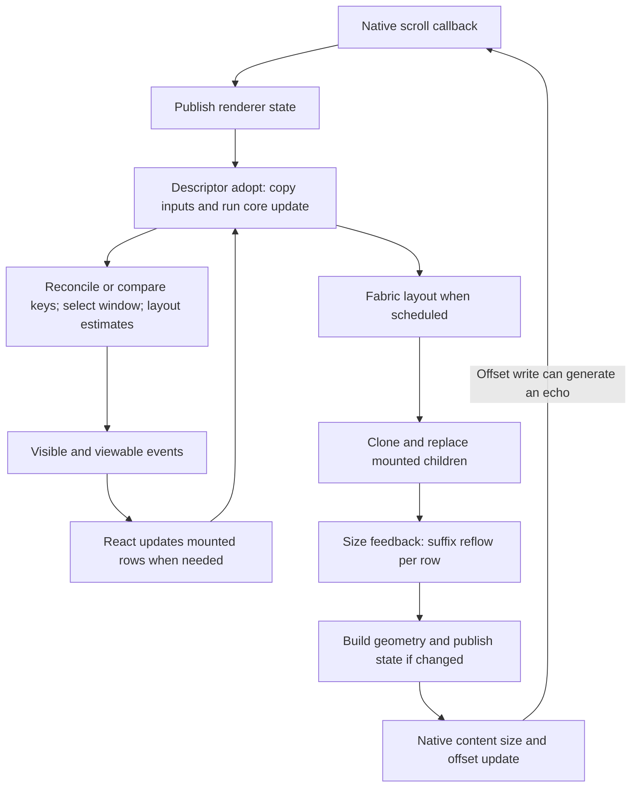

# ShadowList core and Fabric performance report

Date: 2026-09-06  
Revision examined: `42d306db787270e926db10c6d2368f91a04fb6ed`  
Scope: `packages/shadowlist-core`, the C++ Fabric integration, React wrappers, and iOS/Android host implementations. macOS conditional paths were inspected where shared with iOS; no macOS application was profiled.

This is an analysis report. No library implementation, application code, dependencies, or existing tests were changed. A temporary diagnostic program exercised the existing core; its source is included in the appendix for reproduction.

Follow-up: [Fabric events, React state, and shadow-node analysis](FABRIC_PIPELINE_REPORT.md) traces the pinned RN renderer implementation, including state/event coalescing, speculative adoption, stale snapshots, and prioritized integration optimizations.

## Assessment

The largest opportunity is to make work proportional to **what changed and what is mounted**, rather than repeatedly processing the entire dataset. Native views are virtualized, but substantial core and Fabric bookkeeping is still proportional to total item count. Some paths multiply that cost by the number of mounted rows.

The highest-priority findings are:

1. Every row replaced during Fabric layout feeds its size into the core, which reflows the entire suffix even for an unchanged size. A layout with `M` mounted rows can therefore perform approximately `M × N` element visits near the start of an `N`-row list.
2. The default partially estimated list repeatedly assigns fallback sizes and recomputes all offsets. Even after eliminating that reflow, full key comparisons and a full sizing scan remain on ordinary updates.
3. Fabric copies every key into a fresh frame input on each adoption. Long keys introduce an allocation per string, making key representation materially important.
4. Snap and sticky geometry are rebuilt or copied through state updates even when only the scroll offset changed. Android additionally serializes and converts that geometry.
5. Multi-column visibility is represented as one contiguous index range. With uneven column heights, that range can contain many rows that do not overlap the viewport or overscan region.

Existing optimizations are useful: key-based lookup, skipping unchanged-key reconciliation, tail-only content-size calculation, React row memoization, mounted-window hysteresis, and native sticky/drag transforms. They should be preserved. However, they do not make the entire scroll path `O(window)`.

No FPS improvement or percentage speedup is claimed. The timing results below establish the cost of current core operations on this host; proposed gains remain unimplemented and unmeasured.

## Evidence and limitations

Findings use three evidence levels:

| Evidence    | Meaning                                                                                                              |
| ----------- | -------------------------------------------------------------------------------------------------------------------- |
| Measured    | The unmodified core was exercised by an isolated C++ diagnostic program.                                             |
| Code-proven | The work and trigger are visible in the examined implementation. Its contribution to device latency is not measured. |
| Hypothesis  | A plausible improvement requiring an instrumented application or prototype to establish its benefit.                 |

The working tree was clean when analysis started. Navigation used symbol outlines for supported TypeScript/Java files and targeted source reads for C++/Objective-C++, which SymbolPeek does not support. The C++ review focused on ownership, copying, allocation, and lock boundaries.

The package and example declare React Native `0.85.0` and React `19.2.3`; peer support is broader. React Native dependencies were not installed in the workspace. Relevant framework behavior was checked against the upstream `v0.85.0` Yoga source and official renderer documentation. No dependencies were installed and no native application was built or launched.

Measured environment: macOS ARM64, Apple Clang `21.0.0` (`clang-2100.0.123.102`), C++17, `-O3 -DNDEBUG -DSHADOWLIST_DEBUG_LOG=0`. Exact CPU model was unavailable through the sandbox. These are single-threaded host timings, not iOS/Android device measurements. They exclude React, Yoga, text/image measurement, event delivery, JNI, mounting, GPU work, and lock contention.

The existing core CMake Release target built successfully and CTest passed **one placeholder test**. That test is `CHECK(true)`; Fabric's test is `it.todo('write a test')`. These results establish buildability, not behavioral coverage. See [core placeholder](packages/shadowlist-core-tests/tests_placeholder.cpp#L1), [Fabric placeholder](packages/shadowlist-fabric/src/__tests__/index.test.tsx#L1), and [test build](packages/shadowlist-core-tests/CMakeLists.txt#L1).

## How the cost accumulates



This is a dependency diagram, not a guarantee of one layout or JS render per scroll callback. Framework scheduling can skip or combine intermediate work. Renderer state changes can originate in native code, while layout and mounting have separate scheduling and thread constraints. The diagram applies the repository's callbacks to the [official React Native render pipeline](https://reactnative.dev/architecture/render-pipeline).

The follow-up confirms that RN 0.85.0 coalesces adjacent same-family state submissions, while `adopt()` runs on node creation/cloning, potentially before a successful commit. Layout's `setStateData()` attaches output to the current node; it does not itself enqueue another state transaction. See [the detailed pipeline](FABRIC_PIPELINE_REPORT.md#1-the-actual-feedback-loop).

Terminology used below:

| Symbol | Meaning                                                                    |
| ------ | -------------------------------------------------------------------------- |
| `N`    | Total rows in the core revision                                            |
| `M`    | Mounted element children, including persistent/dragged rows                |
| `W`    | Rows whose geometry actually overlaps the requested viewport plus overscan |
| `D`    | Rows preceding the requested window in a single-column list                |
| `C`    | Column/track count                                                         |
| `H`    | Sticky section-header count                                                |
| `P`    | Requested persistent-key count                                             |
| `K`    | Number of rows whose measured dimensions actually changed                  |

| Operation                                      | Current cost and trigger                                          |
| ---------------------------------------------- | ----------------------------------------------------------------- |
| Fabric frame key preparation                   | `O(N)` string copies, plus string bytes; every `adopt()`          |
| Unchanged-key detection                        | `O(N)` string comparisons; every core `update()`                  |
| Single-column window selection                 | `O(D + W)`; scans from index zero and stops after the upper bound |
| Multi-column window selection                  | `O(N)`; global early exit disabled                                |
| Fallback-size scan                             | `O(N)` per measure, even when no offsets need changing            |
| Offset reflow with remaining unestimated rows  | `O(N)` per measure under the normal partial-estimation state      |
| One size feedback                              | `O(N - index)` even when dimensions are identical                 |
| Fabric row feedback during a layout invocation | `O(sum(N - mountedIndex))`; worst case `O(MN)`                    |
| Yoga child lookup without suggested index      | `O(M)` per replacement; potentially `O(M²)` over the layout loop  |
| Snap generation                                | `O(N)` per list layout with snapping enabled                      |
| State geometry copying                         | `O(H + snapCount)` at multiple native/Fabric boundaries           |
| JS data preparation                            | Several `O(N)` passes per data/key-extractor identity change      |
| Content total calculation                      | Already `O(C)` plus constant cached cross-axis work               |

This table describes the examined algorithms. It does not assert that every listed operation executes once per display frame.

## Measurements of the current implementation

### Method

The probe uses the actual core sources. Keys are built outside timed sections. Default geometry is a `390 × 840` viewport with `120`-unit row heights, one column, and overscan `1`. Core callbacks are absent in these probes.

For warm operations, the probe runs three untimed warmups and seven timed batches, reporting the median batch mean. A batch contains 25 operations for ordinary updates, short-key copies, and snap generation; 10 for long-key copies; and 5 for measurement batches, reconciliation, and element construction. Cold update uses seven fresh containers and reports the median, with container destruction outside the timer. These are descriptive samples, not statistically powered latency percentiles.

The fully measured fixture stamps geometry and flags directly during setup and then reflows it. This avoids an `O(N²)` setup caused by measuring all rows one at a time. It represents a stable geometry state; it does not simulate the cost of visiting all rows. The partial fixture is produced by ordinary `Virtualizer::update()` calls. Warm top/deep probes repeat the same offset to isolate bookkeeping; they are not simulated fling trajectories. The deep offset is `(N - 20) × 120`.

Allocation columns come from a separate single invocation with ordinary C++ `new`/`new[]` counting enabled. Requested bytes are cumulative allocation requests, **not retained memory, RSS, or peak memory**. Direct `malloc`, aligned allocation, and platform allocations are outside that counter. Timing includes temporary destruction for copy/vector operations. There is no optimized implementation in the probe.

### Scaling results

All values in this table are **microseconds per operation**, except the measurement rows, which time a batch of 20 calls.

| Scenario                                    | 1,000 rows | 10,000 rows | 100,000 rows |
| ------------------------------------------- | ---------: | ----------: | -----------: |
| Warm top update, partially estimated        |      4.195 |      47.345 |      428.802 |
| Warm top update, fully measured             |      3.278 |      30.537 |      296.902 |
| Warm deep update, fully measured            |      3.790 |      37.463 |      372.593 |
| 20 unchanged measurements at start          |     18.225 |     209.833 |    1,972.308 |
| 20 unchanged measurements at midpoint       |      9.017 |     103.167 |      974.825 |
| 20 unchanged measurements in final 20 rows  |      0.775 |       0.575 |        0.533 |
| Copy short keys into new `FrameInput`       |      0.982 |       8.553 |       83.685 |
| Copy long keys into new `FrameInput`        |     22.092 |     172.417 |    1,738.575 |
| Generate snap offsets                       |      1.553 |      12.197 |      123.193 |
| Reconcile alternating append-one/remove-one |     93.342 |     858.408 |   10,296.800 |
| Cold first update                           |    100.459 |     860.333 |    8,817.958 |
| Construct and destroy `N` default Elements  |     71.442 |     611.508 |    6,067.650 |

Short keys are `k0`, `k1`, etc. Long keys have the prefix `message-0123456789abcdef-0123456789abcdef-` followed by the index. The reconciliation timing includes construction of the added row on append operations and discarding it on removal, but excludes a subsequent layout. The element-construction probe includes random-ID generation and object destruction; it does not isolate formatting alone.

At 100,000 rows, seven-batch min/max means were 411.827–440.705 µs for the partial top update, 1,937.825–2,010.492 µs for the 20 unchanged start measurements, 1,692.179–1,757.229 µs for long-key copying, and 9,972.300–10,463.433 µs for reconciliation.

The roughly constant cost of the final 20 measurements is consistent with suffix traversal. The increase in fully measured update time with `N` demonstrates that fixing fallback estimation alone will not eliminate dataset-sized scroll work.

### Allocation and geometry results

| Operation at 100,000 rows                              | Counted allocation calls | Requested bytes |
| ------------------------------------------------------ | -----------------------: | --------------: |
| Warm core update with short keys supplied by reference |                        0 |               0 |
| Copy short keys into frame input                       |                        1 |       2,400,000 |
| Copy long keys into frame input                        |                  100,001 |       7,200,000 |
| Generate snap offsets                                  |                        1 |         800,000 |
| Append-one reconciliation allocation sample            |                  200,004 |      32,800,208 |
| Default element-vector construction                    |                        1 |      11,200,000 |

The absence of allocations in a core update does not cover Fabric, which constructs a fresh frame and copies its keys first. Conversely, short-key copies do not allocate once per string on this libc++ build. The measured `std::string` size is 24 bytes; `Element` is 112 bytes. String storage behavior and struct size must be rechecked for Android's actual ABI/library.

After repeated top updates, **99,985 of 100,000 elements still had `estimated == false`**, although `layoutElements()` had assigned fallback dimensions. That confirms the persistent reflow trigger in finding F2.

For 10,000 fully measured rows in two tracks, even-index rows were 1,000 units high and odd-index rows 20 units high. At offset 10,000 with the same viewport and overscan, the core counted **130 overlapping elements**, but emitted indices **18 through 1,169**, a **1,152-row span**. The wrapper adds up to four rows per side, producing a 1,160-row requested mounted range here. The native geometry result was measured; the React mounting consequence follows from `rangeToIndices()` and was not run in an application.

## Prioritized findings

Priority indicates expected value and ordering, not a production incident severity. P1 should lead an optimization effort; P2 is workload-dependent or best addressed after P1; P3 is a smaller or specialized opportunity. Effort is relative: S = localized change, M = coordinated changes with targeted regression work, L = architectural or protocol work.

| ID  | Opportunity                                                  | Priority                   | Effort | Evidence                                |
| --- | ------------------------------------------------------------ | -------------------------- | ------ | --------------------------------------- |
| F1  | Skip unchanged measurements and batch true size changes      | P1                         | M      | Measured + code-proven                  |
| F2  | Stop recurring fallback reflow and full sizing scans         | P1                         | M      | Measured + code-proven                  |
| F3  | Avoid per-adoption key copies and redundant key validation   | P1                         | M      | Measured + code-proven                  |
| F4  | Seek directly to the visible window                          | P1                         | M      | Code-proven; update scaling measured    |
| F5  | Version and share snap/sticky geometry                       | P1 for snap/large sections | M      | Code-proven; snap generation measured   |
| F6  | Represent multi-column visibility as sparse rows/ranges      | P1 for uneven columns      | L      | Geometry measured + code-proven         |
| F7  | Reuse existing key indexes and specialize simple mutations   | P2                         | M      | Measured + code-proven                  |
| F8  | Reduce per-element startup and metadata cost                 | P2                         | S–M    | Measured + code-proven                  |
| F9  | Reduce renderer state-update frequency safely                | P2                         | L      | Code-proven trigger; benefit hypothesis |
| F10 | Avoid unnecessary child clones and linear replacement lookup | P2                         | S–M    | Code-proven                             |
| F11 | Share JS key metadata and preserve flattened row identity    | P2                         | M      | Code-proven                             |
| F12 | Tune and bound mounted-range hysteresis                      | P2                         | M      | Code-proven                             |
| F13 | Cache native template handles and sticky lookup position     | P2 Android; P3 otherwise   | S–M    | Code-proven                             |
| F14 | Shorten shared-core lock hold time                           | P2 after F1–F5             | M      | Code-proven; contention hypothesis      |
| F15 | Remove avoidable refresh delivery latency                    | P2 for refresh             | M      | Code-proven                             |
| F16 | Reduce repeated drag and keyboard animation work             | P3                         | M      | Code-proven; impact hypothesis          |

### F1. Unchanged size feedback reflows the list suffix

**Evidence.** [Fabric layout](packages/shadowlist-fabric/cpp/react/renderer/components/ShadowListViewSpec/ShadowListViewShadowNode.cpp#L161) clones and replaces every valid mounted element. The [replacement override](packages/shadowlist-fabric/cpp/react/renderer/components/ShadowListViewSpec/ShadowListViewShadowNode.cpp#L384) passes its dimensions to `updateElementAtIndex()`. The [core method](packages/shadowlist-core/Virtualizer.cpp#L683) has no equal-dimensions early return and unconditionally invokes `recomputeElementOffsets(container, index)` at line 723.

This cost occurs for placement-only replacements too; it is not restricted to rows whose images or text actually resized. The loop can visit the same suffix repeatedly. For 20 consecutive rows starting at index zero in a 100,000-row list, it visits `20 × 100,000 - (0 + ... + 19) = 1,999,810` elements, even if all 20 dimensions are identical. A persistent row at index zero introduces an additional full suffix pass whenever it is processed, even during deep scrolling.

**Opportunity.** Separate measurement intake from offset propagation. Preserve the first-real-measurement transition even if its dimensions equal the estimate; skip geometry propagation for already measured rows with unchanged effective dimensions. Collect changed measurements, update their statistics, then propagate once from the earliest affected index and resolve anchor compensation against the final geometry. Cross-axis-only changes may need cross-extent maintenance without changing scroll-axis positions.

With the current flat layout, this changes a batch from `O(sum(N - i))` to approximately `O(K + N - minChangedIndex)`. With `K = 0`, suffix work should disappear. This is the first optimization to investigate because it amplifies overscan, persistent rows, and all other commit activity.

**Constraints.** Layout currently interleaves placement and measurement through `replaceChild()`. A batch must acquire trustworthy measurements before using final offsets, preserve Yoga ownership, update measured counts only once, and avoid transient anchor corrections from partially applied sizes. Multi-column cross-axis normalization also matters. Merely deferring the existing function until the end can position earlier children using stale geometry.

**Validation.** Count feedback calls, equal-size calls, genuinely changed rows, suffix visits, and anchor writes. Compare unchanged geometry, async row growth/shrink, prepend while scrolled, persistent first row, horizontal lists, and multiple columns. Exact geometry and anchor behavior must remain stable.

### F2. Fallback rows repeatedly trigger full layout

**Evidence.** [Window estimation](packages/shadowlist-core/Virtualizer.cpp#L388) marks selected rows estimated. [Full-list fallback sizing](packages/shadowlist-core/Virtualizer.cpp#L437) assigns dimensions to other `!estimated` rows but leaves that flag false. Each such row sets `anyNewlyEstimated = true` on every call. The subsequent condition at line 494 reflows from index zero. The unconditional sizing loop also remains `O(N)` when every row is estimated.

The comment at lines 480–484 describes the intended `O(window)` scroll behavior, but does not account for the unconditional loop or the persistent fallback flags. The partial and fully measured timing fixtures expose both costs.

**Opportunity.** Track whether fallback geometry has been materialized for the current geometry/estimate generation. Update it when relevant inputs change, rather than treating unchanged fallback assignments as new geometry every frame. Track dirty ranges or unresolved rows so the full sizing loop can be skipped after geometry settles.

**Constraints.** Do not blindly set `estimated = true` in the fallback loop. The current distinction affects window estimates, the first frozen real average, and how unseen rows receive fallback sizes. Define the state transitions explicitly: unsized, fallback-sized, window-estimated, and natively measured, or an equivalent generation-based model. Header/window/orientation/column changes must invalidate the correct geometry. Preserve the intended stable average used by maintain-visible-content-position (MVCP).

**Validation.** An unchanged settled update should cause zero offset reflows; a changed estimate or layout input should cause the required one. Check empty/refill, partial and complete dataset replacement, initial inverted positioning, and first measurement batches.

### F3. Fabric duplicates and revalidates the entire key collection

**Evidence.** [Descriptor adoption](packages/shadowlist-fabric/cpp/react/renderer/components/ShadowListViewSpec/ShadowListViewComponentDescriptor.h#L124) creates a local `FrameInput` and copies `elementsAllKeys`. The [core update](packages/shadowlist-core/Virtualizer.cpp#L165) then compares every key when counts match. Memoizing `elementsAllKeys` in React avoids rebuilding the JS array during window-only renders, but does not remove this C++ copy.

At 100,000 rows, the copy probe used 2.4 MB of requested storage with short keys and 7.2 MB/100,001 allocation calls with long keys. Long-key copying alone measured about 1.74 ms here. At the same dataset size, the fully measured top update still took about 0.30 ms without the Fabric copy.

The descriptor also copies ignored-anchor keys and builds sticky indices. The core copies sticky indices again and clears/reinserts the ignored-key hash set every update. Those are feature-dependent costs; the public `ShadowList` wrapper currently passes an empty ignored-key list.

**Opportunity.** Borrow immutable key data for the synchronous core call, or share a separately owned immutable key snapshot. Associate a trustworthy dataset identity/version with the shared core so an offset-only update can skip full key validation. Cache sticky/anchor policy metadata using its own identity/version. Sharing a whole Props pointer alone is insufficient because unrelated prop changes can create new Props with unchanged keys.

**Constraints.** A borrowed view must not survive its owner's lifetime. A cached identity must remain valid across concurrent shadow-node clones and avoid pointer-reuse/stale-revision mistakes. Do not replace string comparison with hashing every key on every scroll; that is still dataset-sized work. Same-length reorder and key-extractor changes must invalidate the snapshot. Keep the standalone core's safe full-input path if necessary.

**Validation.** Count copied key bytes, allocation calls, and comparisons separately on unchanged state, unrelated props, append, prepend, same-length reorder, dataset swap, and long keys.

### F4. Window selection scans from the beginning

**Evidence.** [measureNextRevision](packages/shadowlist-core/Virtualizer.cpp#L342) starts at index zero. Single-column layouts stop at the upper bound, but still skip every preceding row. Multi-column layouts scan all `N` rows. [captureAnchor](packages/shadowlist-core/Virtualizer.cpp#L856) already binary-searches the single-column boundary, showing that a monotonic search is compatible with part of the current geometry model.

**Opportunity.** For valid single-column geometry, find the first row whose trailing edge exceeds the lower bound, then scan only the overlap window: `O(log N + W)`. A last-window cursor can make ordinary nearby scrolling cheaper, with binary search for jumps. For columns, use per-track searches; the implementation assigns tracks by `index % columns`, so each track has its own ordered offsets even though global row order does not.

A prefix-sum tree is a later option for frequent arbitrary height updates: point-size changes and position queries can become logarithmic. It is a larger change because the code currently exposes eagerly materialized offsets. Start with search and batching before replacing the layout representation.

**Constraints.** Reconciliation leaves stale pre-reorder offsets until reflow; existing code deliberately disables early exit in that state. Search only a valid geometry generation, or reflow first. Include rows beginning before the lower bound whose bodies still overlap. Validate nonnegative, finite extents/gaps before relying on monotonicity. Orientation transitions and cross-track ordering require explicit invalidation.

**Validation.** Window results must match exhaustive overlap checks at start/middle/end, jumps, tall/zero-height rows, gaps, reorders, horizontal lists, and skewed tracks. Track elements inspected per query, not just elapsed time.

### F5. Snap and sticky geometry travel with high-frequency scroll state

**Evidence.** [Fabric layout](packages/shadowlist-fabric/cpp/react/renderer/components/ShadowListViewSpec/ShadowListViewShadowNode.cpp#L295) copies state before determining whether publication is needed. It then rebuilds sticky arrays and calls [getSnapOffsets](packages/shadowlist-core/Container.cpp#L172), builds a second converted vector, and compares it with the previous one. Unchanged geometry avoids publication but not construction/comparison.

State owns ordinary vectors. The descriptor copies state at [line 46](packages/shadowlist-fabric/cpp/react/renderer/components/ShadowListViewSpec/ShadowListViewComponentDescriptor.h#L46); iOS copies it in [scrollViewDidScroll](packages/shadowlist-fabric/ios/ShadowListView.mm#L480). Android's [partial-state constructor](packages/shadowlist-fabric/cpp/react/renderer/components/ShadowListViewSpec/ShadowListViewState.h#L55) copies previous geometry. Its [getDynamic](packages/shadowlist-fabric/cpp/react/renderer/components/ShadowListViewSpec/ShadowListViewState.h#L105) serializes all arrays. Native state application [copies geometry on iOS](packages/shadowlist-fabric/ios/ShadowListView.mm#L377) and [allocates/converts snap arrays on Android](packages/shadowlist-fabric/android/src/main/java/com/shadowlist/ShadowListView.java#L570); [Android sticky caching](packages/shadowlist-fabric/android/src/main/java/com/shadowlist/ShadowListStickyController.java#L73) allocates three arrays too.

**Opportunity.** Give geometry a generation separate from scroll scalars. Recompute snap/sticky geometry only when a dependency changes, share an immutable geometry snapshot across state copies, and refresh native caches only when the generation changes. A reference to existing state suffices while deciding whether a changed state needs to be constructed. On Android, versioning alone does not eliminate full serialization: the state transport must also avoid repeatedly materializing unchanged arrays, or reuse a native-side cached representation supported by the targeted RN version.

Dependencies include row order/sizes, header/footer geometry, column/orientation changes, snap enablement/alignment, viewport dimensions, sticky-index changes, and inversion. Clamp-to-end snap targets depend on total content extent. No geometry cache should invalidate on a pure offset change.

**Secondary opportunity.** Both [iOS snap selection](packages/shadowlist-fabric/ios/ShadowListView.mm#L533) and [Android snap selection](packages/shadowlist-fabric/android/src/main/java/com/shadowlist/ShadowListView.java#L369) linearly find the nearest target. Binary search can help, but this occurs at release/settle, so repeated transport is the larger target. Global snap order is not guaranteed for uneven multi-column tracks; first establish a sorted deduplicated representation with stable tie behavior.

**Validation.** Count geometry builds, snapshot copies, serialized elements/bytes, Java arrays, and native cache refreshes. Test long snap lists with no geometry changes, dynamic measurements, resize, and feature disablement. Never infer a full JNI round-trip count solely from the number of scroll callbacks; instrument actual state delivery.

### F6. Multi-column range envelopes can defeat virtualization

**Evidence.** Tracks are assigned by modulo in [recomputeElementOffsets](packages/shadowlist-core/Virtualizer.cpp#L523), independently accumulating heights. [finalizeMeasurement](packages/shadowlist-core/Virtualizer.cpp#L417) stores only the minimum/maximum overlapping indices. [rangeToIndices](packages/shadowlist-fabric/src/virtualizer/mountedRange.ts#L36) expands all indices between them. The 130-overlap/1,152-span probe demonstrates the resulting overmount potential.

This layout is a fixed round-robin track assignment, not shortest-column masonry balancing. Uneven cumulative track heights can make nearby physical positions correspond to distant indices. Lowering overscan cannot fully solve that mismatch. More mounted rows also multiply F1 and F10.

**Opportunity.** Publish a sorted set of overlapping indices, or compact ranges per track, and union that with persistent/dragged rows. Per-track window search from F4 then avoids both the full scan and the broad envelope. Changing to shortest-track placement is a separate layout behavior decision, not a transparent performance fix.

**Related correctness constraint.** [getViewableIndices](packages/shadowlist-core/Container.cpp#L402) filters geometry but reduces matches to first/last indices; [JS view-token creation](packages/shadowlist-fabric/src/virtualizer/useViewability.ts#L73) labels every index between them viewable. In skewed columns that can include nonviewable rows. Sparse visibility should preserve exact membership for analytics as well as mounting.

**Validation.** Compare actual overlap count with mounted count across balanced and pathological tracks; verify viewability membership, persistent rows, deep jumps, and native/React identity under inserts. Preserve the simple contiguous fast path for ordinary one-column lists.

### F7. Every structural edit rebuilds maps and element storage

**Evidence.** [reconcileElements](packages/shadowlist-core/Virtualizer.cpp#L774) constructs a temporary key-to-Element map, a new element vector, and a new key-to-index map. This happens even for append-one. The revision already has an [elementIndexByKey](packages/shadowlist-core/Revision.hpp#L14) map.

The alternating append/remove probe measured about 10.3 ms at 100,000 short-key rows. A separate append allocation sample requested about 32.8 MB across 200,004 allocations. This is transient traffic, not a claim that each append retains 32.8 MB.

**Opportunity.** Reuse the previous key-to-index map to locate survivors, avoiding the temporary map that duplicates keys and holds moved Elements. Consider append/truncate fast paths and reflow from the first affected index. A trusted mutation description can avoid validating the whole prefix; without one, detecting a safe fast path may still require an `O(N)` comparison. Arbitrary prepend/reorder in the existing contiguous representation remains at least linear in affected metadata.

**Constraints.** Preserve first-occurrence duplicate-key behavior and ensure a previous Element is consumed only once. Preserve surviving measurement state, full-dataset average reset, removed-anchor behavior, and exception recovery. Moving elements out of the live revision before allocations finish creates an exception-safety concern for any refactor. Do not rely on an unvalidated append hint.

**Validation.** Allocation traffic and mutation latency for append, prepend, trim, middle edit, full reorder, duplicate keys, and full replacement. Run geometry and identity checks after each operation, not only reconciliation timing.

### F8. All rows pay metadata and random-ID startup cost

**Evidence.** Each new [Element](packages/shadowlist-core/Element.hpp#L15) generates a random hex ID using `std::stringstream`. In the inspected core/Fabric runtime, `Element::id` is read by [debug serialization](packages/shadowlist-core/Revision.cpp#L47); operational identity uses `key`. The RNG is already thread-local, so it is not reseeded for each row.

The isolated default-element vector cost was about 6.07 ms for 100,000 elements, compared with a separately measured 8.82 ms cold core update. These measurements overlap in work but have different destruction boundaries; they do not prove that removing ID formatting saves 6.07 ms. On this libc++ build, the 16-character IDs fit without one counted allocation per ID.

`sizeof(Element) == 112` means 100,000 rows require 11.2 MB for the element vector alone, before keys that spill string storage, hash-map entries, props, JS data, and React/native rows. Geometry scans repeatedly touch records containing strings and debugging metadata.

**Opportunity.** Generate debug IDs lazily or use a cheaper identifier if the public/debugging contract permits it. Longer-term, separate frequently scanned numeric geometry from colder identity/debug metadata, or represent estimated regions compactly. These are candidates for startup and cache-locality improvements, not justification to narrow every numeric type.

**Constraints.** `Element` is a public core type; absence of internal ID consumers does not prove external consumers do not use it. Keep identity stable across reconciliation. Using floats everywhere to save memory can lose precision for very large content extents; measure and define coordinate limits first.

**Validation.** First core update, time to first stable content, live/peak memory, and allocation traffic with short/long keys. Isolate ID generation in a future comparison before attributing its entire construction cost to formatting.

### F9. Every native scroll report requests a renderer state update

**Evidence.** [iOS scrollViewDidScroll](packages/shadowlist-fabric/ios/ShadowListView.mm#L442) publishes state after refresh guards. [Android updateScrollState](packages/shadowlist-fabric/android/src/main/java/com/shadowlist/ShadowListView.java#L509) constructs a map and publishes each report. Neither path has a visible-range boundary test or explicit per-display-frame coalescer. Adoption runs a core update.

Core visible/viewable events and React mounted-range updates already deduplicate, but that occurs after input preparation and much of the core work. Also, [descriptor callbacks](packages/shadowlist-fabric/cpp/react/renderer/components/ShadowListViewSpec/ShadowListViewComponentDescriptor.h#L64) always install scroll and viewable observers, even when the public wrapper omits those JS handlers. Consequently, the core's listener-presence guard does not skip its viewability computation in this integration. The [follow-up RN 0.85.0 source review](FABRIC_PIPELINE_REPORT.md#e3-omitting-a-js-handler-does-not-stop-native-event-preparation) confirms that ordinary emitter dispatch and JSI payload construction also occur before a missing public consumer can avoid callback execution.

**Opportunity.** First make individual updates cheaper. Then measure whether native reports can be coalesced to the latest offset per display frame, or whether a native window/geometry snapshot can defer renderer work until mounted coverage needs changing. User-facing `onScroll` cadence and internal virtualization updates should have separate requirements. Explicit listener capability can avoid optional viewability/scroll work when unused; sticky overlay tracking still needs its visibility input.

**Constraints.** Preserve final offset delivery, edge callbacks, gesture takeover, immediate command handling, correction acknowledgment, and sufficient overscan during fast flings. UI-thread sticky transforms must remain responsive independently. Do not replace the current path with a timer that adds unconditional latency or rely on JS to drive every physical scroll frame.

A protocol detail requires special care: `FrameInput.commitToken` is populated by Fabric but is not consulted by the current core update/resolve logic, and the descriptor does not forward a live `scrollPhase`. Current behavior relies on offset confirmation and `userScrolled`. Scheduling changes must be checked against actual logic, not comments implying complete token/phase reconciliation.

**Validation.** Count native reports, state submissions, adoptions, layouts, JS events, React commits, and mounts separately. Measure their ratios during slow scroll, fast fling, correction, and JS congestion. No fixed commit-per-frame assumption is warranted from static analysis.

### F10. Fabric clones stable children and omits a known replacement index

**Evidence.** The layout loop [clones every row](packages/shadowlist-fabric/cpp/react/renderer/components/ShadowListViewSpec/ShadowListViewShadowNode.cpp#L176), sets layout metrics, and pushes it into `affectedNodes` without checking whether the resulting metrics differ. Header/footer/empty/section overlay paths do the same. The row loop knows `i`, but calls `replaceChild()` without it; the override's [default is `SIZE_MAX`](packages/shadowlist-fabric/cpp/react/renderer/components/ShadowListViewSpec/ShadowListViewShadowNode.h#L45).

The upstream RN `v0.85.0` Yoga replacement implementation uses the suggested index if accurate; otherwise it searches the child vector. Therefore this loop can add quadratic child lookup work on top of core suffix reflows. Passing the known index offers a localized candidate improvement. This conclusion concerns the Yoga child-vector lookup; it does not claim every framework replacement operation becomes constant-time. See [versioned YogaLayoutableShadowNode implementation](https://raw.githubusercontent.com/facebook/react-native/v0.85.0/packages/react-native/ReactCommon/react/renderer/components/view/YogaLayoutableShadowNode.cpp).

**Opportunity.** Compute desired metrics against a const child first and clone only when necessary. Preserve mandatory Yoga ownership clones and newly obtained measurements. Avoid adding unchanged placement entries to `affectedNodes`, while retaining entries collected by framework layout and other surface nodes. Pass accurate replacement indices where known.

**Constraints.** Unchanged placement does not imply measurement is already recorded. Do not skip first measurement or mutate a shared sealed node. Repeated `affectedNodes` entries do not necessarily mean duplicate JS `onLayout` delivery because downstream event handling may deduplicate; the proven issue is unnecessary local bookkeeping and clone/replacement work.

**Validation.** Clones and replacement searches per layout, affected-node count, onLayout correctness for rows and siblings, Yoga ownership assertions, and actual mounting mutations. Test supported RN versions before relying on an internal optimization.

### F11. JS metadata is duplicated and flattening invalidates row memoization

**Evidence.** [useMountedRange](packages/shadowlist-fabric/src/virtualizer/useMountedRange.ts#L60) builds a full key-to-index Map, and [ShadowList](packages/shadowlist-fabric/src/ShadowList.tsx#L183) independently builds the full key array. [usePersistentKeys](packages/shadowlist-fabric/src/virtualizer/usePersistentKeys.ts#L25) scans the full data for a nonempty persistent set. [drag lookup](packages/shadowlist-fabric/src/virtualizer/useDragReorder.ts#L36) independently uses `findIndex`.

These data-wide passes are memoized, so they are **not all per-scroll work**. They recur on data/key-extractor identity changes; persistent-key identity also matters. Sharing one derived metadata object can avoid repeated extraction and let sparse persistent/drag keys resolve by lookup. Duplicate-key semantics need to remain explicit: persistent selection currently includes every matching row, whereas the mounted map uses the first occurrence.

[SectionList](packages/shadowlist-fabric/src/SectionList.tsx#L79) creates a new wrapper object for every row when its flattening dependencies change. [TreeList](packages/shadowlist-fabric/src/TreeList.tsx#L99) rebuilds all expanded-visible rows and its index on every expansion-set change. Collapsed descendants are skipped, but offscreen expanded descendants are still traversed. New wrappers change `element` identity for mounted rows, defeating the existing memo boundary even if underlying content is unchanged.

**Opportunity.** Derive keys/indexes once, share them internally, preserve wrapper identity for unchanged rows/sections, and consider subtree splicing for large tree updates. Include section context, depth, expansion status, separator boundaries, and item indices in invalidation; caching only by item key is insufficient.

**Correctness constraint.** [ElementRenderer's child memo](packages/shadowlist-fabric/src/virtualizer/ElementRenderer.tsx#L24) invokes `renderElement({ element, index })` but omits `index` from its dependencies. A prepend/reorder that retains the same item object and render function can therefore leave index-dependent content stale. React requires reactive values used in a memo calculation to be represented in its dependency list; see [useMemo documentation](https://react.dev/reference/react/useMemo). Do not treat this stale rendering as a performance win or introduce further index omissions when preserving wrapper identity.

**Validation.** Key-extractor call counts, flattening time, JS allocation/GC, mounted row render counts, and index-dependent row content for appends, reorders, expansion, and unchanged section objects. Avoid forcing all consumers into a new data API before those costs are measured.

### F12. Overscan and range retention need coordinated limits

**Evidence.** Native overscan defaults to one viewport each side. [useMountedRange](packages/shadowlist-fabric/src/virtualizer/useMountedRange.ts#L117) then pads the native reported range by four rows each side and retains the existing mounted range while it contains the new range. `overscan = 0` therefore does not imply viewport-only React mounting.

For uniform single-column rows away from edges, mounted demand is roughly `(1 + 2 × overscan) × viewportRows + 8`, subject to boundary rounding and prior retained ranges. All these rows participate in Fabric bookkeeping. Persistent and dragged rows add to that set.

The stored range uses its two boundary keys. A reorder can move those keys far apart; [resolveRange](packages/shadowlist-fabric/src/virtualizer/useMountedRange.ts#L72) mounts everything between their new indices. If later native windows remain contained, the containment shortcut does not shrink the oversized range. Similarly, temporarily increasing overscan or shrinking the viewport can leave more rows retained until the window exits that band. This is not an inherently ever-growing window during normal forward scrolling, but some transitions can retain a large one.

**Opportunity.** Coordinate native coverage and JS hysteresis, and support shrinking/recentering after geometry or structural changes. Preserve enough ready rows for measured event-to-mount latency. A velocity-aware buffer is worth evaluating after F1–F4 reduce the cost of each mounted row. Seed initial mounting from expected physical coverage when possible instead of only a fixed item count.

**Constraints.** Lower buffers can trade CPU/memory savings for blank content during flings. Key-based continuity protects prepends; replacing it with numeric indices alone would regress identity stability. Constrain excessive boundary separation while keeping the visible anchor covered.

**Validation.** Mounted count and blank-area duration for forward/reverse flings, overscan changes, viewport resize, boundary-key reorder, large persistent sets, and expensive rows. Report both memory and responsiveness.

### F13. Android scans mounted children repeatedly for sticky templates

**Evidence.** [applyStickyTranslations](packages/shadowlist-fabric/android/src/main/java/com/shadowlist/ShadowListStickyController.java#L99) scans all content children once for header/footer dimensions and again for transforms. It then [searches for the section overlay](packages/shadowlist-fabric/android/src/main/java/com/shadowlist/ShadowListStickyController.java#L279). These walks occur even for a plain list with no sticky templates. [Mounting each element](packages/shadowlist-fabric/android/src/main/java/com/shadowlist/ShadowListView.java#L280) also invokes sticky translation, so inserting a batch can produce another quadratic mounted-child traversal pattern.

iOS already retains direct template handles. Both platforms linearly scan header geometry to find the active section; JS also scans sticky indices when viewability changes. For many sections, a search or active-position cursor avoids repeated prefix work.

**Opportunity.** Cache Android header/footer/overlay handles on mount/unmount and their measured sizes on layout change, with a fast path for no sticky features. Preserve reset behavior when features turn off. Cache the active header position or binary-search a validated sorted geometry array. Reapply unchanged transforms/Z order only when needed, without missing newly mounted rows.

**Validation.** Child visits, sticky lookups, mount-batch time, and UI-thread duration on plain lists and lists with thousands of sections. Preserve overlay ordering, collision/push-off behavior, and template replacement/recycling.

### F14. Shared-core locking magnifies the expensive work

**Evidence.** A single [Container mutex](packages/shadowlist-core/Container.hpp#L280) protects shared mutable state across shadow-node clones. [adopt](packages/shadowlist-fabric/cpp/react/renderer/components/ShadowListViewSpec/ShadowListViewComponentDescriptor.h#L58) holds it through callback assignment, input preparation, and the core update. [layout](packages/shadowlist-fabric/cpp/react/renderer/components/ShadowListViewSpec/ShadowListViewShadowNode.cpp#L45) holds it through child cloning, measurement feedback, geometry construction, and state preparation. Public core methods recursively reacquire it. [Observer callbacks](packages/shadowlist-core/Container.cpp#L306) execute while the outer update lock is held.

**Opportunity.** First remove unnecessary work inside these regions. Borrow/copy immutable inputs before the lock where safe, use immutable geometry snapshots, and consider collecting observer payloads for dispatch after the critical section. Larger ownership changes could make computation transactional per revision.

**Constraints.** The mutex is part of the actual concurrency contract; removing it or replacing it with an atomic pointer does not make the contained vectors and revision state safe. Event payloads emitted later must remain associated with the correct dataset/revision and emitter, and ordering must be preserved. Recursive-lock overhead alone is unlikely to outrank repeated list traversals. Contention and callback latency have not been measured here.

**Validation.** Instrument acquisition wait and hold time separately, including p95/p99 in device traces, and correlate them with adoptions/layouts for the same list. Concurrent mutation tests are a prerequisite for changing ownership or dispatch timing.

### F15. Refresh can delay data visibility independently of CPU cost

**Evidence.** [useRefreshDefer](packages/shadowlist-fabric/src/virtualizer/useRefreshDefer.ts#L22) holds incoming data during refresh, releasing it via a native settle event or a timer 1,200 ms after `refreshing` becomes false. The Android implementation [stops its spinner](packages/shadowlist-fabric/android/src/main/java/com/shadowlist/ShadowListView.java#L252) but contains no `onRefreshSettle` emission. An eligible Android refresh that holds new data therefore depends on the fallback timer, subject to normal JS scheduling.

iOS [debounces settle](packages/shadowlist-fabric/ios/ShadowListView.mm#L334) by scheduling a new delayed block on each retract-scroll tick; obsolete blocks later return by token comparison. Its nominal delay is 250 ms after the last scheduling call and may repeat while a finger remains down or the offset is negative.

The hook also calls `setCommittedData` during render for ordinary data identity changes, even when refresh deferral is disabled. That requests another render of the component; it does not establish an extra native commit. It is a smaller avoidable body-execution cost compared with the explicit refresh latency.

**Opportunity.** Release data on a reliable platform settle/completion signal, with bounded fallback behavior. Keep the hold only while it protects an active refresh animation; let ordinary updates flow without mirror-state retries where the hook contract permits it. On iOS, a single cancellable scheduled check or completion mechanism can reduce stale block creation.

**Validation.** Measure network completion → `refreshing=false` → data released → first stable frame separately. Preserve the reason for the existing hold: prevent refresh-prepend anchor jumps during retract/bounce. Compare Android and iOS, interrupted refreshes, and delayed JS execution.

### F16. Specialized drag and keyboard paths have smaller opportunities

**Drag.** Android's [frame callback](packages/shadowlist-fabric/android/src/main/java/com/shadowlist/ShadowListDragController.java#L295) updates every display frame while dragging. [updateDrag](packages/shadowlist-fabric/android/src/main/java/com/shadowlist/ShadowListDragController.java#L356) scans for insertion and reapplies sibling shuffle even if insertion is unchanged. Gesture and state callbacks can also call it. iOS has equivalent scans and per-view key conversion. Track finger motion, scroll, mounted-child changes, and insertion changes separately so sibling transforms update only when affected. Keep dragged-row positioning live. Both platforms already stop their drop polling with completion or an approximately 300 ms fallback; this is **not** an unbounded-polling finding.

**Keyboard.** The optional [keyboard animation hook](packages/shadowlist-fabric/src/keyboard/useKeyboardAnimation.ts#L12) receives per-frame native events and calls two `Animated.Value.setValue` operations on JS. iOS [emits interpolated frames](packages/shadowlist-fabric/ios/ShadowListKeyboard.mm#L178), while Android [emits IME animation progress](packages/shadowlist-fabric/android/src/main/java/com/shadowlist/ShadowListKeyboardModule.java#L143). Consumers requiring synchronized motion under JS load may benefit from native-driven animation values or an optional UI-runtime integration. This is not the default list inset path: [useKeyboardInset](packages/shadowlist-fabric/src/keyboard/useKeyboardInset.ts#L74) subscribes to show/hide events and measures overlap, rather than streaming every frame.

**Validation.** Count drag work per display frame and transformed siblings; measure input-to-pixel latency under JS load. For keyboard consumers, compare event delay and animation continuity. Preserve module enable reference counts and cleanup. Avoid adding a new mandatory animation dependency based solely on this static review.

## Cross-cutting implementation constraints

The following details can invalidate apparently successful optimizations:

- **Estimate stability:** the average freezes from real measurements and survives partial reconciliation. A cache must preserve intended MVCP behavior rather than silently changing estimates each frame.
- **Cross-axis shrinking:** partial offset recomputation only grows `maxCrossAxisExtent`. Removing incidental full reflows can expose stale oversized content after a wide/tall row shrinks. Maintain an exact maximum or invalidate it when its contributor changes; see [recomputeElementOffsets](packages/shadowlist-core/Virtualizer.cpp#L512).
- **Layout cache synchronization:** Fabric directly updates header/footer/window values and recomputes offsets in [layoutInputsChanged](packages/shadowlist-fabric/cpp/react/renderer/components/ShadowListViewSpec/ShadowListViewShadowNode.cpp#L129), without updating the core's `lastLayout*` cache fields there. The next core layout can consequently repeat a parameter-triggered reflow. A unified geometry generation should cover both paths.
- **Authoritative geometry:** do not binary-search stale offsets after reorder or assume global track ordering. Validate zero/negative/nonfinite sizes and legal gaps before choosing a monotonic algorithm.
- **Identity:** key-based native measurement resolution prevents stale indices from measuring the wrong row after prepend. Preserve it; the extra hash lookup is much cheaper than corrupt geometry.
- **Corrections:** preserve inverted initial bottom pinning, scroll-to-key/end convergence, overscroll behavior, footer/header compensation, and user takeover. An offset echo can be synchronous with a native write.
- **React content correctness:** memoization must reflect the callback's real inputs, including index-dependent render output. Avoid winning a render-count benchmark by retaining stale UI.
- **Framework ownership:** keep immutable/sealed shadow-node rules, Yoga ownership, and the surface-wide `affectedNodes` contract intact. Do not clear the shared affected-node vector to reduce its length.
- **Distribution parity:** Android uses the canonical core when available and falls back to the vendored copy; the podspec mirrors the core on installation. Future device benchmarks must verify that the compiled core matches the intended revision. See [Android CMake](packages/shadowlist-fabric/android/shadowlist/jni/CMakeLists.txt#L8) and [podspec](packages/shadowlist-fabric/ShadowList.podspec#L5).

## What is already efficient, and what to defer

| Existing behavior                        | Why it matters                                                                                     |
| ---------------------------------------- | -------------------------------------------------------------------------------------------------- |
| Key-to-index hash map                    | Anchor and stale-child resolution avoid repeated linear key search in native layout.               |
| Unchanged-key reconciliation guard       | Ordinary updates avoid the much larger map/vector rebuild, though comparison remains linear.       |
| Tail-only total-size computation         | Scroll-axis total scans at most `C` rows, using a cached cross maximum.                            |
| Partial suffix reflow                    | Better than a full reflow per measurement near the end; batching/no-op guards can extend the gain. |
| Single-column anchor binary search       | Existing foundation for faster window lookup.                                                      |
| Visible/viewable/edge deduplication      | Reduces events and JS renders after core work.                                                     |
| Memoized row wrapper and stable styles   | Avoids unnecessary row-content work when identities and dependencies are stable.                   |
| Native sticky and drag transforms        | Keeps continuous movement off the React reconciliation path.                                       |
| Shared core lifetime tied to node clones | No descriptor-level per-list registry growth in the examined design.                               |
| Release logging defaults off             | Diagnostic `printf` calls are not automatically production hot-path costs.                         |

Do not start with a recycler rewrite, wholesale JSI/Nitro migration, lock removal, generalized threading, hash-table replacement, or numeric-type narrowing. None is required to address the measured costs. Native view creation, image decode, text layout, GPU overdraw, accessibility work, and third-party row content may dominate a particular app, but they were not profiled here. Those require application evidence before making library-level claims.

The core exposes `estimatedElementSize`, but the Fabric descriptor leaves the frame default at `120 × 120`; the native/public props do not expose an estimate or deterministic item layout. For known-height workloads, an optional layout/estimate contract could reduce initial correction and measurement work. It would be a public API design decision with invalidation rules for fonts, width, separators, and content changes, not a free internal shortcut. Evaluate after the current no-op work is removed.

## Proposed verification and optimization order

### Phase 1: Establish behavior and counters

Restore meaningful core and integration regression coverage before changing layout/anchor behavior. Add instrumentation only in a future implementation task. Capture:

| Layer           | Required counters/timing                                                                                                                    |
| --------------- | ------------------------------------------------------------------------------------------------------------------------------------------- |
| Core            | Key comparisons; elements scanned; full/suffix reflows; rows visited by reflows; actual size changes; correction count; geometry generation |
| Fabric          | Adoptions; layout invocations; child clones/replacements; measured feedback count; state copies/publications; affected-node entries         |
| State transport | Geometry elements/bytes copied and serialized; Android array allocation; cache generations applied                                          |
| React           | Data preparation/flattening time; key-extractor calls; mounted count; row render count; commit time; GC                                     |
| Native UI       | Scroll reports; mount duration; sticky/drag duration; correction echoes; blank-area duration                                                |
| Concurrency     | Mutex wait and hold duration, correlated by list and commit                                                                                 |

Instrumentation should distinguish a physical frame, a renderer state update, an adoption, a layout invocation, and a React commit. They are different events.

### Phase 2: Remove redundant work without changing the visibility protocol

Address F1's no-op measurement path and known replacement indices, then batch real size changes. Correct F2's fallback/dirty tracking, including exact cross-axis maximum invalidation. Address F3's frame copying and identity validation, and F4's single-column window seek. Use F10's clone guards only after measurement and ownership responsibilities are clear.

Proposed invariants after this phase:

- A stable equal-size feedback batch performs no suffix propagation.
- A batch of changed measurements causes one required propagation, not one per row.
- A geometry-stable, offset-only single-column update performs no full key copy, key comparison, fallback sizing pass, or full offset reflow.
- Window search inspects a logarithmic boundary plus the actual window, rather than the full prefix.

These are targets for later validation, not achieved results.

### Phase 3: Optimize feature workloads

Version/share snap and sticky geometry, remove Android template scans, share JS metadata, preserve flattened row identities, and correct excess mounted-range retention. For uneven columns, prioritize sparse visibility over merely speeding up broad-range rendering. Improve Android refresh release timing as a separate user-visible latency change.

### Phase 4: Re-evaluate architecture using device evidence

Only after the earlier work, decide whether commit-frequency reduction, prefix-sum geometry, compact estimated regions, or recycling is warranted. Those choices change more invariants and need representative end-to-end measurements.

### Device workload matrix

Run release builds on at least one representative iOS device and one constrained Android device, including 60 Hz and 120 Hz where supported. The frame periods are about 16.67 ms and 8.33 ms, respectively; the list shares those periods with the rest of the application. Host microbenchmarks must not be substituted for frame-deadline measurements.

| Workload              | Variations                                                             | Main observations                                     |
| --------------------- | ---------------------------------------------------------------------- | ----------------------------------------------------- |
| Baseline list         | 1k/10k/100k; short/long keys; fixed/variable heights                   | Scaling, allocations, first stable content            |
| Scrolling             | Start/middle/end; slow/reverse/fast fling; JS busy                     | CPU, frame misses, blank area, mount latency          |
| Measurements          | Same-size; async growth/shrink; row near start/middle/end              | Suffix visits, correction convergence, anchor drift   |
| Mutations             | Append/prepend/trim/reorder/full swap                                  | Commit latency, key/measurement preservation          |
| Inverted chat         | Initial mount; prepend history; append at bottom and while scrolled up | Pin/anchor stability, correction echoes               |
| Persistent/drag       | Persistent first row; distant pins; autoscroll; delete mid-drag        | Mounted count, repeated reflows, input latency        |
| Columns               | 2/3/4 tracks; balanced and skewed heights; horizontal                  | Actual overlap vs mounted envelope                    |
| Sections/snapping     | Many short sections; 100k snap targets; alignment/resize               | Geometry transport, sticky lookup, snap accuracy      |
| Refresh/keyboard      | Both platforms; overlapping async updates; JS load                     | Data-release latency, animation continuity            |
| Lifecycle/concurrency | Multiple lists; rapid mount/unmount; overlapping commits               | Retention, lock contention, stale generation handling |

Use CPU samples and allocation traces alongside frame metrics. Report p50/p95/p99 where sample sizes support them, maximum stalls, native and JS memory, mounted-view count, and blank-area duration. Keep data, row content, scroll trajectories, release flags, and build provenance fixed for comparisons. Avoid claiming success from lower CPU if it increases blanks, stale content, or anchor movement.

## Reproduction appendix

The diagnostic work used `/private/tmp/shadowlist-perf-1bOAh3`. This temporary directory is not a permanent deliverable and may be removed by the operating system. The report includes the complete probe below so the evidence can be reproduced independently.

From the repository root, save the appendix program to an analysis directory as `probe.cpp` and compile it against the unmodified source:

```sh
clang++ -std=c++17 -O3 -DNDEBUG -DSHADOWLIST_DEBUG_LOG=0 \
  -I packages /path/to/analysis/probe.cpp \
  packages/shadowlist-core/Virtualizer.cpp \
  packages/shadowlist-core/Container.cpp \
  packages/shadowlist-core/Revision.cpp \
  packages/shadowlist-core/Element.cpp \
  packages/shadowlist-core/Error.cpp \
  -o /path/to/analysis/probe
/path/to/analysis/probe
```

The existing build check was:

```sh
cmake -S packages/shadowlist-core-tests \
  -B /private/tmp/shadowlist-perf-1bOAh3/core-build \
  -DCMAKE_BUILD_TYPE=Release
cmake --build /private/tmp/shadowlist-perf-1bOAh3/core-build -j 2
ctest --test-dir /private/tmp/shadowlist-perf-1bOAh3/core-build --output-on-failure
```

The probe deliberately contains no proposed optimization and is not a regression suite. Its synthetic fixtures isolate algorithmic costs; they do not model a complete Fabric application.

```cpp
#include <shadowlist-core/Virtualizer.hpp>
#include <algorithm>
#include <chrono>
#include <cstdio>
#include <cstdlib>
#include <new>
#include <numeric>
#include <string>
#include <vector>
using namespace azimgd::shadowlist;
using Clock = std::chrono::steady_clock;
static volatile double sink = 0;
static bool countAlloc = false;
static std::size_t allocCalls = 0, allocBytes = 0;
void* operator new(std::size_t n) {
  if (countAlloc) { ++allocCalls; allocBytes += n; }
  if (void* p = std::malloc(n ? n : 1)) return p;
  throw std::bad_alloc();
}
void operator delete(void* p) noexcept { std::free(p); }
void* operator new[](std::size_t n) { return ::operator new(n); }
void operator delete[](void* p) noexcept { ::operator delete(p); }
static FrameInput inputFor(std::size_t n, bool longKeys = false) {
  FrameInput in;
  in.windowContainerWidth = 390; in.windowContainerHeight = 840;
  in.keys.reserve(n);
  for (std::size_t i = 0; i < n; ++i)
    in.keys.push_back((longKeys ? "message-0123456789abcdef-0123456789abcdef-" : "k") + std::to_string(i));
  return in;
}
static void seed(Container& c, const FrameInput& in, bool markEstimated) {
  Virtualizer::update(&c, in);
  if (markEstimated) {
    for (auto& e : c.revision.elements) { e.width = 390; e.height = 120; e.estimated = true; e.measured = true; }
    c.revision.measuredRealCount = in.keys.size();
    c.revision.measuredRealTotalWidth = in.keys.size() * 390.;
    c.revision.measuredRealTotalHeight = in.keys.size() * 120.;
    Virtualizer::recomputeElementOffsets(&c, 0);
    Virtualizer::recomputeTotalSize(&c);
  }
  Virtualizer::update(&c, in);
}
template<class F> static void bench(const char* label, std::size_t n, int iterations, F fn) {
  for (int i=0; i<3; ++i) fn();
  std::vector<double> samples;
  for (int batch=0; batch<7; ++batch) {
    auto t=Clock::now();
    for (int i=0; i<iterations; ++i) fn();
    samples.push_back(std::chrono::duration<double,std::micro>(Clock::now()-t).count()/iterations);
  }
  std::sort(samples.begin(),samples.end());
  allocCalls=allocBytes=0; countAlloc=true; fn(); countAlloc=false;
  std::printf("%s,%zu,%.3f,%.3f,%.3f,%zu,%zu\n",label,n,samples[3],samples.front(),samples.back(),allocCalls,allocBytes);
}
int main() {
  std::printf("sizeof_Element=%zu,sizeof_string=%zu\n", sizeof(Element),sizeof(std::string));
  std::puts("scenario,N,median_us,min_us,max_us,allocation_calls,requested_bytes");
  for (std::size_t n : {1000u,10000u,100000u}) {
    auto in=inputFor(n); Container c; seed(c,in,false);
    bench("steady_partial_top",n,25,[&]{Virtualizer::update(&c,in);sink=c.revision.totalContainerHeight;});
    std::size_t unset=0; for(const auto& e:c.revision.elements) unset += !e.estimated;
    std::printf("unestimated_after_repeated_top,%zu,%zu\n",n,unset);
    Container measured; seed(measured,in,true);
    bench("steady_measured_top",n,25,[&]{Virtualizer::update(&measured,in);sink=measured.revision.totalContainerHeight;});
    auto deep=in; deep.containerOffsetY=(n-20)*120.;
    bench("steady_measured_deep",n,25,[&]{Virtualizer::update(&measured,deep);sink=measured.revision.totalContainerHeight;});
    for (auto start : {std::size_t(0),n/2,n-20}) {
      std::string name="same_size_20_at_"+std::to_string(start);
      bench(name.c_str(),n,5,[&]{for(std::size_t j=start;j<start+20;++j) Virtualizer::updateElementAtIndex(&measured,j,{390,120});sink=measured.revision.elements.back().offsetY;});
    }
    bench("key_copy_short",n,25,[&]{FrameInput frame;frame.keys=in.keys;sink=frame.keys.back().size();});
    auto longIn=inputFor(n,true);
    bench("key_copy_long",n,10,[&]{FrameInput frame;frame.keys=longIn.keys;sink=frame.keys.back().size();});
    measured.snapToItem=true;
    bench("snap_generation",n,25,[&]{auto snaps=measured.getSnapOffsets();sink=snaps.size();});
    auto changed=in.keys;
    changed.push_back("added");
    bool alternate=false;
    bench("append_remove_reconcile",n,5,[&]{Virtualizer::reconcileElements(&measured,alternate?in.keys:changed);alternate=!alternate;sink=measured.getElementsSize();});
    std::vector<double> cold;
    for (int i=0;i<7;++i) {Container fresh;auto t=Clock::now();Virtualizer::update(&fresh,in);cold.push_back(std::chrono::duration<double,std::micro>(Clock::now()-t).count());sink=fresh.revision.totalContainerHeight;}
    std::sort(cold.begin(),cold.end());
    std::printf("cold_update,%zu,%.3f,%.3f,%.3f,NA,NA\n",n,cold[3],cold.front(),cold.back());
    bench("element_construction",n,5,[&]{std::vector<Element> elements;elements.reserve(n);for(std::size_t i=0;i<n;++i)elements.emplace_back();sink=elements.size();});
  }
  Container grid; auto in=inputFor(10000);in.columns=2;seed(grid,in,true);
  for(auto& e:grid.revision.elements)e.height=e.index%2?20:1000;
  Virtualizer::recomputeElementOffsets(&grid,0);Virtualizer::recomputeTotalSize(&grid);
  in.containerOffsetY=10000;Virtualizer::update(&grid,in);
  auto range=grid.getVisibleIndices();
  std::printf("grid_skew,actual_overlap=%zu,range_start=%zu,range_end=%zu,range_span=%zu\n",grid.revision.measurementElementCount,range.first,range.second,range.second-range.first+1);
}
```
